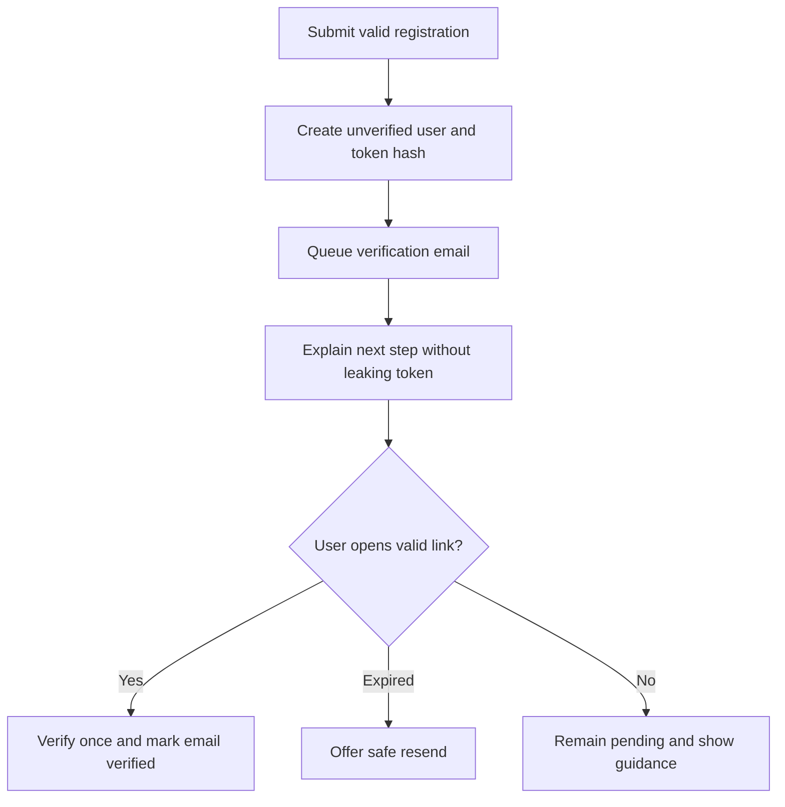
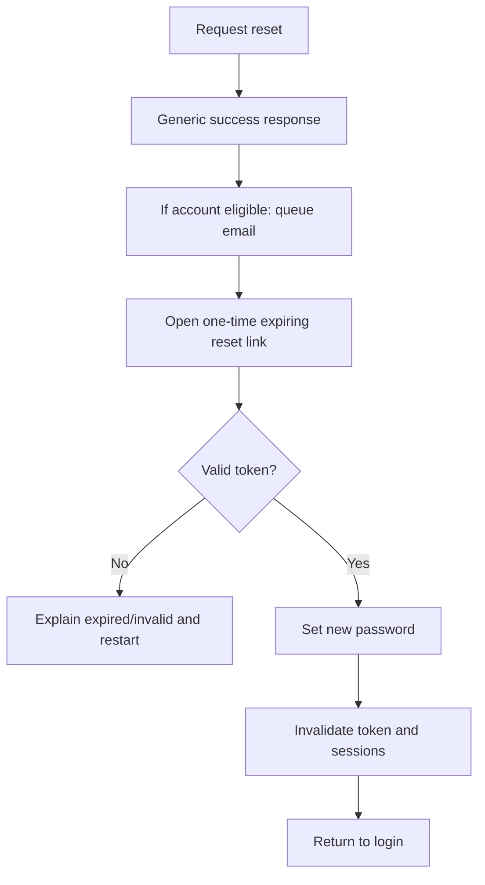

# 02 — Authentication, security, privacy and trust (P0)

## 1. Baseline & findings

**Source to inspect:**
- `backend/src/services/auth.service.ts`, `backend/src/routes/auth.routes.ts`, `backend/src/controllers/auth.controller.ts`, `backend/src/controllers/auth.cookies.ts`
- `backend/src/services/auth-session.service.ts`, `backend/src/services/auth-token.service.ts`, `backend/src/config/env.ts`
- `backend/src/middlewares/rate-limit.middleware.ts`, `backend/src/middlewares/auth.middleware.ts`, `backend/src/app.ts`, `backend/src/config/upload.ts`
- `frontend/src/pages/auth/ForgotPasswordPage.tsx`, `ResetPasswordPage.tsx`, `AuthPage.tsx`, `frontend/src/contexts/AuthContext.tsx`

Observed in inspected baseline:
- Access + refresh token handling, hashed refresh token in DB, httpOnly cookie, role checks and rate limiter exist (reuse).
- Registration/reset flow can issue tokens, **but mail transport/delivery was not found in reviewed implementation**. Frontend claims link has been sent. Verify current HEAD and external infrastructure before asserting production behavior.
- `getClientIp` trusts first user-supplied `X-Forwarded-For` value. Trust chain should instead be configured at known proxies.
- `/api/metrics` needs private-by-default auth even when env token missing.
- Multer image upload checks MIME+extension, not verified file bytes in inspected config.
- Public brand copy makes unverified claims, covered in `06-PUBLIC-UX-MARKETING.md`.

## 2. Solution (recommended)

### 2.1 Production email subsystem

Create a **transactional mail adapter** inside existing Express backend; do not build separate service initially.

Suggested files (adapt to existing conventions):
```
backend/src/services/email/email.provider.ts   # interface
backend/src/services/email/email.service.ts    # compose/queue
backend/src/services/email/email.templates.ts  # verified/reset/booking templates
backend/src/tasks/email-outbox.task.ts          # reliable asynchronous delivery
backend/prisma/schema.prisma                    # EmailOutbox optional
```

Requirements:
1. Provider selected by deployment config (SMTP/Resend/Postmark etc.); never hardcode vendor API key.
2. `MailProvider.send({to,template,templateVersion,params,idempotencyKey})` adapter; test with fake provider.
3. Emails have subject, safe URL, expiration description, contact channel, no secret or password echo.
4. Use outbox/DB transaction for reliable enqueue when needed; retries with capped exponential backoff and dead-letter status. If minimal MVP skips outbox, document reliability gap and add a retry-safe mechanism before beta.
5. Email verification token/reset token: use cryptographically random, persist only hash, TTL, single-use, rotate on resend, redact from logs.
6. Password reset response should not reveal whether email exists. Rate limit per IP and normalized email, protect abuse.
7. After reset: revoke relevant refresh sessions, reauthenticate deliberately, prevent replay.
8. Email and redirect origins must be on explicit allowlist; never construct reset URL from arbitrary Host header.
9. Avoid leakage of tokens via Referer; use suitable referrer policy and landing route that removes token from visible URL/history after validation where feasible.
10. Current UI should say 'Nếu email hợp lệ, hướng dẫn sẽ được gửi' only when dispatch path genuinely exists.

### 2.2 Endpoint and infrastructure protections

- Configure `trust proxy` for **known reverse-proxy hops/networks**, use Express `req.ip` appropriately; reject/sanitize spoofed forwarded headers at the edge. Test direct request + trusted proxy + forged XFF.
- For rate limiting: prefer Redis atomics for distributed deployment; memory-only fallback should be explicit and restrictive. Confirm limiter fails safely and does not silently exempt traffic under Redis outage.
- Metrics: production require token or private route/network even if `METRICS_TOKEN` missing; safest default is return 404/403 for unauthenticated clients. Never expose PII, tokens, raw SQL queries, internal exceptions.
- Add Helmet and Content-Security-Policy suited to frontend assets, fonts, uploads, Socket.IO; test production-like build and avoid unsafe-inline where possible.
- Review CORS, secure/SameSite cookies, CSRF boundaries for cookie endpoints, JSON body size and file upload caps.
- Image upload: magic-byte validation and safe transcoding / sanitization, separate storage and content type, virus scan if threat profile requires; disallow HTML/SVG unless securely sanitized and needed.
- Enforce authorization for every resource (booking, message, assessment attempt, audit logs) including Socket.IO rooms/events.
- Security scan: dependencies, secret scan, public env, source maps, logs; avoid shipping debug secrets.
- Audit who changed role, verification status, user status and mentor approval; avoid raw sensitive data in logs.

### 2.3 Personal data & minors

- Create public `Privacy Policy` and `Terms` with review from product/legal owner; do not fabricate legal compliance.
- Specify retention of Holland answers, birth/education info (if any), messages, booking notes, analytics events, ML datasets.
- Provide account export/delete or deletion request workflow and documented retention exceptions.
- Minimize training data, remove direct identifiers, separate analytics from identity, require appropriate consent for minors.
- Avoid sharing individual score/assessment details with mentors/admin beyond documented authorized purpose and role.
- Add consent version and timestamp only if necessary; avoid collecting additional PII without demonstrated need.

## 3. Behavior specification

### Signup


### Reset


## 4. Acceptance criteria

- [ ] Signup → inbox email → verify → login tested on staging with test mailbox.
- [ ] Forgot password → delivery → new password → old token invalid; old sessions revoked; unknown email response indistinguishable.
- [ ] 0 tokens/secrets appear in production logs or API error payloads.
- [ ] Metrics rejects unauthenticated traffic regardless of env config.
- [ ] Rate limiter cannot bypass limit with arbitrary `X-Forwarded-For`.
- [ ] Security headers verified against app functionality and Socket.IO.
- [ ] Upload refuses executable/HTML disguised as image and oversized uploads.
- [ ] Data retention/privacy text accurately reflects real backend behavior.

## 5. Test matrix

- Email provider timeout, intermittent 429, duplicate send, queue retry, account deleted mid-send.
- Expired/reused token, concurrent verify links, reset brute-force, valid/invalid email enumeration, registration replay.
- Proxy misconfiguration, Redis unavailable, burst requests, socket role revoked mid-session.
- Malformed files, wrong signature, 6MB+ image depending env, content type spoofing.
- Request forbidden record via guessed ID (IDOR); permission denial in admin/mentor/student.

## 6. Non-goals

- No custom SMTP server infrastructure.
- No direct storing plaintext tokens/passwords.
- No claim of legal certification without independent review.
