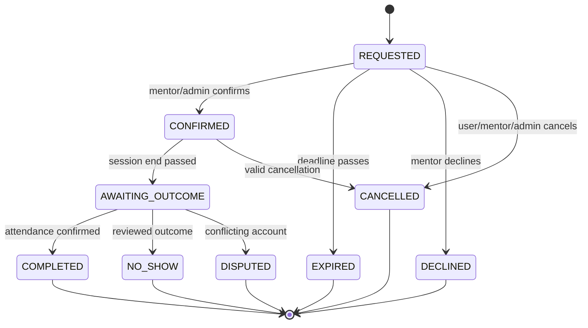

# 03 — Mentor booking: business integrity, concurrency, lifecycle (P0)

## 1. Source and observed risks

Files: `backend/src/services/booking.service.ts`, `backend/src/routes/booking.routes.ts`, `backend/src/tasks/scheduled.tasks.ts`, `backend/src/services/notification.service.ts`, `frontend/src/pages/admin/AdminBookingsPage.tsx`, `frontend/src/pages/mentor/MentorBookingsPage.tsx`, `frontend/src/components/mentor/BookingDialog.tsx`.

Observed baseline:
- `createBooking` uses Prisma transaction but conflict detection is read-before-create; **possible concurrent race, must reproduce**.
- `getBookingSettingOrDefault` includes `autoConfirm`, but new booking is created as `REQUESTED` in inspected `createBooking` path. Check whether other paths auto-confirm.
- `markOverdueBookingsAsNoShow` changes confirmed bookings to `NO_SHOW` after end+grace; **time passing does not establish attendance**.
- Time input parsed with local `new Date(year, month, date, hour, minute)`; server timezone assumptions are a risk.
- `REQUESTED` counts as active; stale requests may block capacity, if not expired elsewhere.
- Admin UI displays all actions regardless status and dismisses detail before async mutation success; backend rejects illegal statuses.
- Mentor has `hourlyRate`, but reviewed backend did not show integrated payment pipeline. Choose business model before advertising payment guarantees.

## 2. Recommended business state machine

Suggested new states (requires migration & compatibility plan):
- `REQUESTED`: user submitted request; response deadline recorded.
- `CONFIRMED`: mentor accepted; session link/meeting instructions available.
- `DECLINED`: mentor refused; reason optional.
- `EXPIRED`: request not accepted before deadline.
- `CANCELLED_BY_STUDENT`, `CANCELLED_BY_MENTOR`, `CANCELLED_BY_ADMIN` (can retain legacy enums with `cancelledBy` instead to avoid breaking schema).
- `AWAITING_OUTCOME`: end passed, attendance unresolved.
- `COMPLETED`: session acknowledged/completed.
- `NO_SHOW`: attendance evidence and authorized decision, not automatic from time alone.
- `DISPUTED`: optional if business will manage paid bookings; defer if not needed.

**MVP migration-minimizing alternative:** keep existing enums; add `expiredAt`, `attendanceStatus`, `outcomeReviewRequired` metadata instead of introducing 5 new statuses immediately. The agent must compare cost and existing API consumers and document an ADR before selection.

> Schema mapping can differ; semantic transitions and auditability are mandatory.

## 3. Highest-priority fixes

### BKG-01 — Eliminate automatic false NO_SHOW
- Do not mark all ended `CONFIRMED` as absent.
- Background task may move them to `AWAITING_OUTCOME` or attach `needsOutcome=true` and notify mentor.
- Allow mentor/student to confirm participation in a reasonable window; admin reviews disagreement.
- Check existing `markOverdueBookingsAsNoShow` and related job; migrate/reconcile old incorrectly marked entries only through approved migration.
- Preserve audit history including actor, previous state, new state, reason, timestamp.

### BKG-02 — Safe concurrency control
- Define booking lock scope: `mentorId` (and/or resource/day) and protect critical section for `assertNoOverlap` + insert/confirm.
- MySQL/InnoDB option: transaction + `SELECT ... FOR UPDATE` over stable mentor row or dedicated booking lock row; capture correctness in integration tests. Beware locking absent slots and isolation levels; robustly serialize all creators and confirms through same lock.
- Avoid only `findMany` then `create` under default isolation; retry deadlocks with bounded backoff.
- Use idempotency key for client retry of create if possible; ensure no duplicate notifications.
- `adminConfirmBooking` and `confirmMentorBooking` should invoke same state-check/lock strategy.

### BKG-03 — Expire pending requests
- On REQUESTED insert, `responseDueAt` based on configured policy; e.g. min(booking start–notice threshold, creation+24h); exact policy owner approval.
- Job marks stale requests EXPIRED with guarded update; recalculate active slots/counts; send notification once.
- Show deadline in StudentBookings and mentor inbox.

### BKG-04 — AutoConfirm semantics
- Decide whether auto confirm is supported; default OFF.
- If ON, create `CONFIRMED` atomically only after availability & conflict checks; establish conversation, timestamp and notification.
- If not supported, remove setting and references rather than showing misleading control.

### BKG-05 — Timezone correctness
- DB canonical instants UTC; store `timezone` IANA (e.g. Asia/Ho_Chi_Minh) with mentor calendar or business setting.
- Interpret date+time with explicit zone; validate DST ambiguity/nonexistent slots for future multi-country use.
- All displays have zone label; formatter should use user locale/zone, not Node host local zone.
- `BookingDialog.todayInputValue()` currently relies on UTC ISO date; fix to local mentor/user zone for date picker.

### BKG-06 — Transaction UX
- Only render enabled actions valid for current state, plus reason/tooltip for unavailable actions if helpful.
- Do not close detail modal before mutation success; pending state disables duplicates; inline error persists on failure.
- Admin destructive actions require confirmation, reason where appropriate; no-show needs supporting context.
- For expired/declined/cancelled show timeline and safe next action; do not show confirm/complete.

## 4. Reliable notifications and meeting workflow

- Existing in-app Socket/Notification remains the primary channel; email optional through adapter once implemented.
- One event per transition using outbox/idempotent dedupe key; ensure retry cannot duplicate reminder.
- Confirmed booking must display how to meet (meeting URL / location / chat instructions), date, duration, timezone, cancel policy. Decide whether meeting link is entered by mentor or auto-generated from an approved provider.
- Before: learner can send 1–3 goals/questions; after: session outcome and optional mentor summary with privacy rule.
- Reviews only on `COMPLETED` and exactly once, preserving existing constraint.

## 5. Payment policy decision (not implementation by default)

**Option A — recommended MVP:** IT Compass connects mentors and students, booking record is **not payment or payment guarantee**. Explicitly disclose prices as information and where payment happens; describe dispute/help channel; avoid 'paid/confirmed' language if no payment processor.

**Option B:** Payment is part of product. Requires `PaymentIntent`, `Transaction`, `Refund`, payout, provider webhooks, retries, reconciliation, policy, accounting and legal review. Implement only after product owner selects model and provider.

## 6. Acceptance criteria

- [ ] 50+ concurrent request test on same slot never creates overlapping active bookings; actual count & thresholds defined by test.
- [ ] Every create/update is idempotent or explicitly safe on retries; no duplicate notification in test.
- [ ] Pending booking expires and no longer occupies capacity according to documented policy.
- [ ] Confirmed session is **not automatically classified as no-show** without attendance evidence.
- [ ] Mentor timezone and UTC-host deployment produce identical displayed appointment instant.
- [ ] `autoConfirm` setting behavior and UI match.
- [ ] Admin buttons respect state and dialog remains open with error on failed API request.
- [ ] Student/mentor can determine meeting method, time zone and cancellation policy.
- [ ] Review remains available only once after completed attendance.

## 7. Tests

- Parallel create same slot, create vs confirm, cancel vs confirm, mentor/admin simultaneous transition, duplicate POST retry.
- Stale request, booking starts before due, clock drift, different timezones, midnight edge, DST zone.
- DB deadlock/retry, Redis/socket outage, notification dedupe, invalid status API forging.
- Cancellation during meeting, no-show after meeting actually completed, dispute resolution state.
