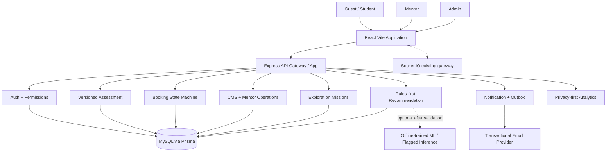

# 18 — Recommended end-state architecture & solution rationale

## 1. One-sentence solution

**Giữ full-stack hiện tại làm lõi tin cậy, thêm các module theo nhu cầu thật, tập trung on-device educational interaction, có phân lớp scoring và recommendation, không thay lõi bằng LLM.**

## 2. Architecture map (target, incremental)

## 3. Module boundaries

- **Auth:** identity, session, consent; never embed career rules.
- **Assessment:** question catalogs, version, answers, scoring, breakdown and evidence; no mentor booking operations.
- **Discovery:** mission engine, attempts, user feedback; never awards authoritative skills or psychological diagnoses.
- **Recommendation:** collates authorized assessment/discovery content; returns structured explanations, no raw LLM truth.
- **Booking:** mentor availability, appointment status transitions, attendance and notifications; transaction semantics central.
- **CMS:** educational content, public routing, moderated comments and editorial review.
- **Analytics:** event capture and aggregated reporting; access policies independent of transactional data.
- **Admin:** UX for overseeing operational queues; controllers enforce backend permissions.

## 4. Why this is better than alternatives

### Against 'rewrite in Next.js/other stack'
- Changing framework doesn't repair booking integrity, misleading result claims, email delivery or operator comprehension.
- Current React Router/Vite/lazy loading are serviceable; solve measurable SEO/TTFB issues first, then document if SSR truly necessary.

### Against 'ML predicts major now'
- Without valid labels, high offline accuracy is circular. Rule-based transparency + optional activity recommender has a clearer evaluation loop.

### Against 'more animation everywhere'
- Visually rich site already uses Motion. Largest wins come from simpler call to action, task-oriented navigation, form preservation, error recovery and measured activation.

### Against 'admin charts first'
- Operators must address pending bookings and approvals. Action inbox and status-based controls reduce labor and business risk better than more charts.

### Against 'microservices for everything'
- Current product scale and feature composition favor well-factored Express modules, Prisma transactions and selective background jobs. Split services only when justified by independent scaling/deploy needs.

## 5. Future proofing rules

- Publish API schema/version contracts; preserve V1 assessment artifacts, tagged scenarios, stable user IDs.
- Timestamp instants UTC; business TZ explicit; no local environment assumptions.
- Transactions on critical state changes; outbox for reliable side effects; idempotency on potentially retried requests.
- Feature flags + schema expand/contract rollouts.
- Separate interest, interaction behavior, feedback and skill claims.
- No unverified social proof; analytics events versioned and privacy-safe.
- Design system and accessibility semantics centralized.

## 6. Priority of return on effort

1. **High immediate impact/low relative effort:** correct marketing claims, fix soft-delete copy, remove inert search, state-gate booking actions, show error instead of fake zero.
2. **High impact/medium-to-high effort:** booking safety/expiry/TZ, auth email, CI/test, CMS unsaved guard, admin action queue.
3. **High strategic impact/medium effort:** rework beginner questions and scoring UI, first-value landing/guest preview.
4. **Differentiator/high effort:** mission engine and three experiences, discovery profile.
5. **Research investment/uncertain upside:** ML (only after feedback and holdout labels).

## 7. Release principles

- No production rollout without measured test, privacy review and rollback.
- One issue/PR when possible. No simultaneous all-at-once UI redesign.
- Update these `.md` docs as source changes, include baseline SHA and date in PR report.
